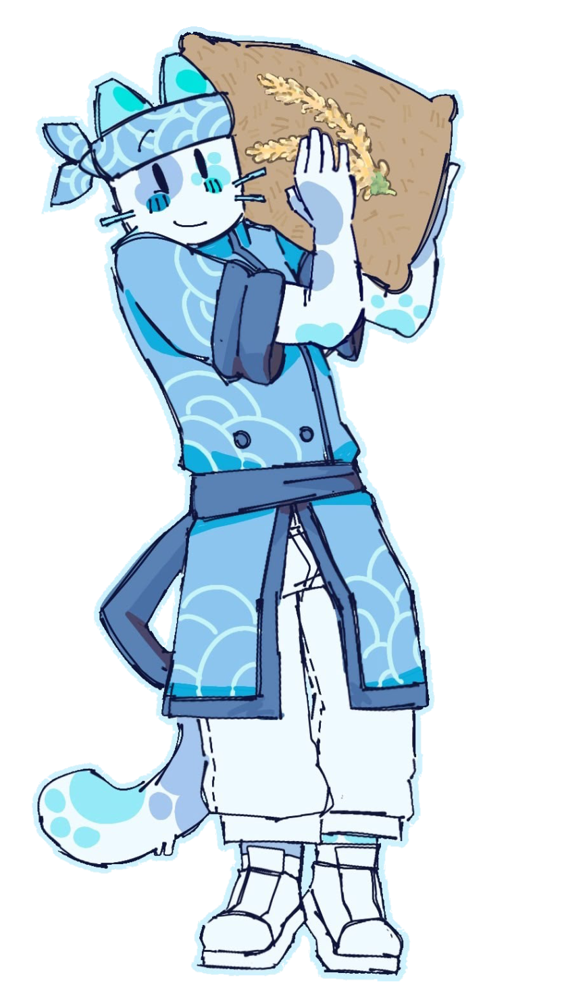
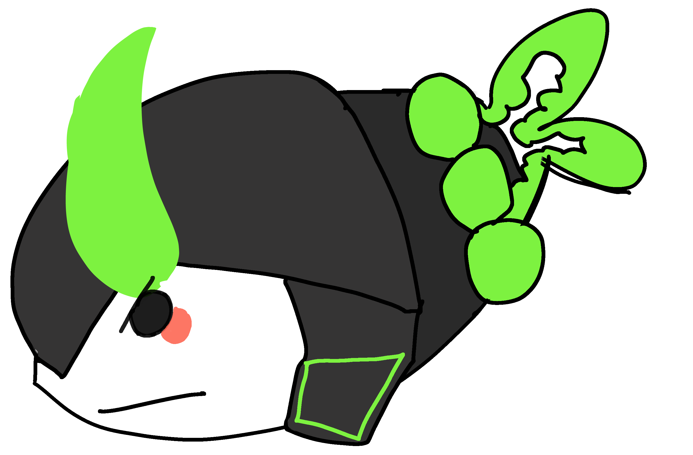
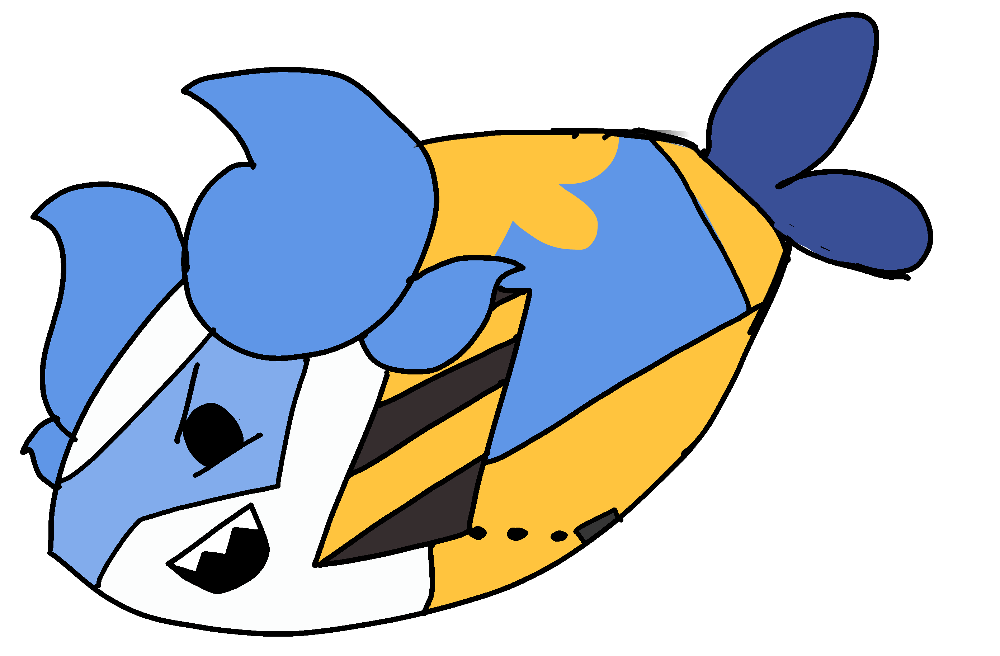
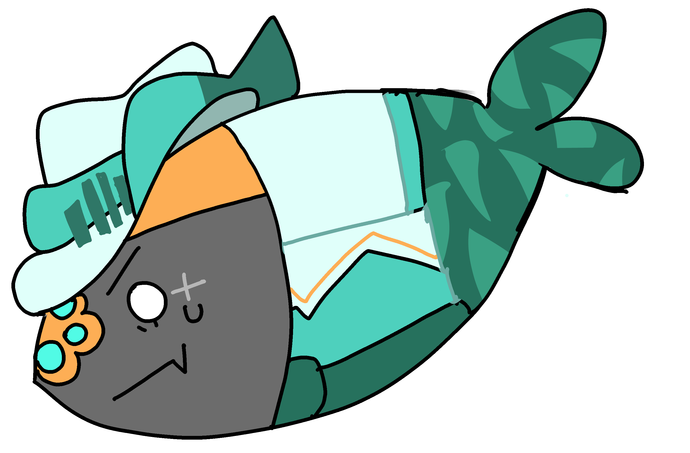

${\textsf{\color{#94C9EB}Fawn or sling}}$   ${\textsf{\color{#3A6EAB
}-11 dni}}$  ${\textsf{\color{#94C9EB}mentally ill}}$

${\textsf{\color{#6B7C9C}he/him}}$  ${\textsf{\color{#94C9EB}mirror prn}}$  ${\textsf{\color{#6B7C9C}paw/pawself}}$

${\textsf{\color{#3A6EAB}adhd}}$ ${\textsf{\color{#94C9EB}+}}$ ${\textsf{\color{#6B7C9C}anxitey}}$  ${\textsf{\color{#94C9EB}iwc +}}$ ${\textsf{\color{#3A6EAB}dniu}}$ ${\textsf{\color{#6B7C9C}first}}$

${\textsf{\color{#3A6EAB}hey senpai, notice me٩( 'ω' )و}}

<a href="LINK1">patreon </a>
<a href="LINK2">straw </a>
<a href="LINK3">prns </a>
<a href="LINK4">rblx</a>

 

  rika,   griefer,  isaac.

